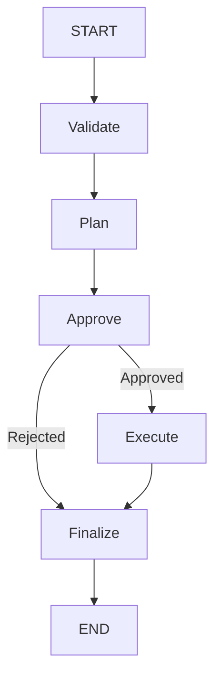

# LangGraph Task Agent

A TypeScript learning project that combines a Next.js UI, an Express API, and a LangGraph workflow. Enter a task, review a Gemini-generated plan, and approve or reject it. Approved plans receive a short generated note for each step.

The project demonstrates graph state, nodes, conditional routing, structured model output, and human-in-the-loop interrupt/resume behavior. The execution node currently generates text guidance; it does not perform external actions or call tools.

## Stack

| Layer | Technologies |
| --- | --- |
| Frontend | Next.js 16, React 19, TypeScript, Tailwind CSS 4, Radix/shadcn-style UI components |
| API | Express 4, TypeScript, Zod, dotenv |
| Workflow | `@langchain/langgraph`, `Annotation.Root`, `MemorySaver` |
| Model | Gemini through `ChatGoogleGenerativeAI` from `@langchain/google-genai` |

LangChain handles the model calls and structured responses. LangGraph handles workflow execution, state updates, branching, and pausing for human input.

## Workflow



| Node | Behavior |
| --- | --- |
| `validate` | Trims input, cancels whitespace-only input, and truncates long input to 300 characters plus an ellipsis. |
| `plan` | Requests a beginner-friendly plan using a Zod structured-output schema and keeps at most five steps. |
| `approve` | Interrupts the graph with the planned steps and later reads the human response. |
| `execute` | Makes another model call to generate notes and pairs them with the planned steps. |
| `finalize` | Produces the final status, message, steps, and results. |

Cancelled input still follows the graph edges, but planning and approval skip their work when the state is cancelled. Rejection routes directly to finalization and skips the execution model call.

## Project layout

```text
backend/
  src/
    index.ts                  Express server and CORS configuration
    routes/graph.ts           Start and approval endpoints
    utils/env.ts              Environment loading and validation
    graph/
      graph.ts                State annotations, graph wiring, start/resume helpers
      types.ts                Zod state schema and TypeScript types
      nodes/
        01_validate.ts
        02_plan.ts
        03_approve.ts
        04_execute.ts
        05_finalize.ts
client/
  src/
    app/page.tsx              Run, approve, and reject handlers
    components/task-agent/
      AgentForm.tsx           Task input
      RunLogs.tsx             Loading, approval, and results views
    lib/api.ts                Backend fetch helpers
    lib/types.ts              Frontend response types
```

## Local setup

You need Node.js and npm compatible with Next.js 16, a Gemini API key, and access to a Gemini model supported by your account and the installed integration. Node.js 22 or newer is a practical choice for this project.

### 1. Install dependencies

From the project root:

```sh
cd backend
npm ci
cd ../client
npm ci
cd ..
```

There are separate package manifests and lockfiles for the backend and client; there is no root npm workspace or combined startup command.

### 2. Configure the backend

Create `backend/.env`:

```dotenv
GEMINI_API_KEY=your_gemini_api_key
GEMINI_MODEL=your_supported_gemini_model_id
PORT=5000
```

| Variable | Required | Behavior |
| --- | --- | --- |
| `GEMINI_API_KEY` | Yes | Passed explicitly to the backend model integration. |
| `GEMINI_MODEL` | No | The code defaults to `gemini-3.5-flash-lite` when omitted; choose a model available to your account. |
| `PORT` | Yes | Backend listening port; use `5000` to match the client's default URL. |

Run the backend from its own directory so dotenv loads `backend/.env`. Keep the API key on the backend.

### 3. Configure the client

Create or update `client/.env.local`:

```dotenv
NEXT_PUBLIC_API_URL=http://localhost:5000
```

This setting is optional for local development because the API helper already defaults to that URL. It is public configuration, not a place for an API key. Keep it consistent with any existing `client/.env` configuration, and restart the client after changing it.

Environment files are ignored by Git.

### 4. Start both apps

In one terminal:

```sh
cd backend
npm run dev
```

In another terminal:

```sh
cd client
npm run dev
```

Open [http://localhost:3000](http://localhost:3000). The backend CORS configuration accepts that exact frontend origin. If you use a different hostname or frontend port, update `backend/src/index.ts` accordingly.

On Windows PowerShell, use `npm.cmd` instead of `npm` if execution policy blocks the npm PowerShell launcher.

### 5. Try a run

1. Enter a task such as "Create a one-week JavaScript interview preparation plan."
2. Click **Run Agent**.
3. Review the generated steps.
4. Click **Approve & Continue** to generate notes, or **Reject Plan** to cancel.
5. Read the final result.

## How approval and resume work

Starting a task creates a new thread ID and invokes the graph with:

```ts
const config = { configurable: { thread_id: threadId } };
const result = await graph.invoke(makeInitialState(input), config);
```

The approval node calls the interrupt helper supplied by its node config/runtime with a serializable payload containing the steps. LangGraph saves progress and surfaces the payload under `__interrupt__`. The start helper extracts it and returns the thread ID and plan to the UI. The first HTTP request then finishes.

The UI sends a separate approval request. The backend resumes the same thread:

```ts
await graph.invoke(
  new Command({ resume: { approve } }),
  { configurable: { thread_id: threadId } }
);
```

The checkpoint identifies the paused node. That node restarts from its beginning, and its interrupt call returns the resume value. The node converts `decision.approve` into the state update `{ approved }`; the conditional edge then chooses `execute` or `finalize`.

`approve` is a key in the resume answer. `approved` is a graph state field. Sending a resume answer does not itself update state.

## State

| Field | Meaning |
| --- | --- |
| `input` | Task text after validation/normalization |
| `steps` | Generated plan |
| `approved` | Human decision written by the approval node |
| `results` | Array of `{ step, note }` objects |
| `status` | `planned`, `done`, or `cancelled` |
| `message` | Human-readable outcome |

Nodes return partial updates. Fields not included in an update retain their existing values. The current annotations use replacement behavior rather than custom accumulating reducers.

The Zod `StateSchema` in `types.ts` supplies the inferred TypeScript `State` type. The graph uses `StateAnn` from `Annotation.Root`; the whole-state Zod schema is not explicitly parsed by the start helper. Request bodies and model output have their own schemas.


## Live streaming

The frontend sends `Accept: text/event-stream` on both POST endpoints. Express streams SSE frames while the graph runs. Clients that omit that header still receive the JSON API responses shown below.

The plan and execution nodes keep their structured-output schemas and two-model-call workflow. Gemini streams JSON text; callbacks decode partial arrays into display-only previews through LangGraph's `custom` stream mode. Completed model output is still validated before being committed to graph state. Approval controls appear only after the validated plan reaches the interrupt.

Each SSE frame contains a JSON event in its `data` field:

```text
data: {"type":"preview","node":"plan","items":["Review JavaScript fund"]}

data: {"type":"preview","node":"plan","items":["Review JavaScript fundamentals."]}

```

| Event | Payload | Purpose |
| --- | --- | --- |
| `started` | `threadId` | Identify the run. |
| `preview` | `node`, `items` | Replace the current plan/notes preview with the latest partial array. |
| `progress` | `node` | Indicate a completed graph node. |
| `needs_approval` | `threadId`, `steps`, `prompt` | Display the validated plan and approval buttons. |
| `final` | `final` | Replace the preview with the completed graph result. |
| `error` | `message` | Report a failure after streaming headers have been sent. |

Preview arrays are snapshots, not text deltas: the browser replaces the relevant array rather than appending it. Raw JSON syntax is never displayed. Model chunks may contain several tokens, so update frequency depends on the provider.

The first stream closes at the approval pause. Clicking Approve opens a new stream for the same thread and progressively fills the result notes. Rejecting produces a cancelled final result without an execution model call.

The fetch-based SSE reader buffers incomplete frames and decodes UTF-8 incrementally. It detects truncated connections and explicit error events. Closing the connection or unmounting the page aborts the in-progress graph/model request. Heartbeat comments keep idle connections active; deployment proxies must permit unbuffered streaming.

Malformed requests receive HTTP 400 JSON errors before a stream opens. Once SSE headers have been sent, failures are sent as `error` events rather than changing the HTTP status.


## HTTP API

### Start a run

`POST /agent`

```json
{
  "input": "Create a JavaScript interview preparation plan."
}
```

A planned task returns an approval request. Example response (generated text varies):

```json
{
  "status": "ok",
  "data": {
    "kind": "needs_approval",
    "interrupt": {
      "threadId": "t_example",
      "steps": ["Review core concepts.", "Practice coding questions."],
      "prompt": "Approve the generated plan to continue, or reject to cancel."
    }
  }
}
```

The start endpoint can also return `data.kind: "final"` when the graph finishes without an approval pause.

### Approve or reject

`POST /agent/approve`

```json
{
  "threadId": "t_example",
  "approve": true
}
```

Use the thread ID from the start response. Set `approve` to `false` to reject. The response is:

```json
{
  "status": "ok",
  "data": {
    "kind": "final",
    "final": {
      "input": "Create a JavaScript interview preparation plan.",
      "approved": true,
      "status": "done",
      "message": "Executed 1 step(s)",
      "steps": ["Review core concepts."],
      "results": [
        {
          "step": "Review core concepts.",
          "note": "Focus on scope, closures, promises, and the event loop."
        }
      ]
    }
  }
}
```

For JSON clients, malformed request bodies return HTTP `400` and caught workflow/model failures return HTTP `500`. Error bodies use `{ "status": "error", "error": "..." }`. Streaming failures use the SSE error event described above.

## Development checks

Type-check the backend without emitting files:

```sh
cd backend
npx tsc --noEmit
```

Build the frontend:

```sh
cd client
npm run build
```

Run the streaming regression tests from the backend directory with `npm test`. They use mocked Gemini chunks and a local HTTP server to cover previews, approval/resume, rejection, concurrent runs, validation, JSON compatibility, fragmented SSE/UTF-8, failures, and disconnect cancellation. No real model calls are made. A backend production start/build script is not defined.

## Current limitations

- Checkpoints use process memory. Backend restarts lose runs, and separate backend instances do not share them.
- The UI keeps its pending thread ID in React state; reloading the page loses the reference to the pending run.
- The graph currently contains one approval node. The streaming runner checks for pending interrupts after both start and resume; the legacy JSON resume helper still assumes a final result.
- Execution produces model-generated notes. It has no tool execution, external task actions, or chat-history loop.
- The note count is requested in the prompt but not enforced to equal the step count by the schema. Pairing uses the shorter array, so a result can contain fewer notes than steps.
- Authentication and per-user authorization of thread IDs are not implemented.

## Learning references

- [LangGraph Graph API](https://docs.langchain.com/oss/javascript/langgraph/graph-api)
- [LangGraph interrupts](https://docs.langchain.com/oss/javascript/langgraph/interrupts)
- [LangGraph streaming](https://docs.langchain.com/oss/javascript/langgraph/streaming)
- [LangGraph persistence](https://docs.langchain.com/oss/javascript/langgraph/persistence)
- [LangChain Google integration used by this project](https://docs.langchain.com/oss/javascript/integrations/chat/google_generative_ai)

This README describes the existing implementation rather than upgrading it to newer API examples.
