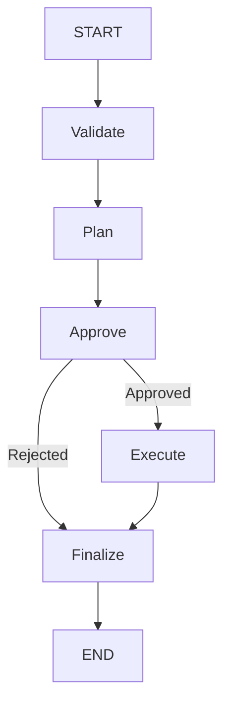

# LangGraph Task Agent

A TypeScript learning project that combines a Next.js UI, an Express API, and a LangGraph workflow. Enter a task, review a Gemini-generated plan, and approve or reject it. Approved plans receive a short generated note for each step.

The project demonstrates graph state, nodes, conditional routing, structured model output, and human-in-the-loop interrupt/resume behavior. The execution node currently generates text guidance; it does not perform external actions or call tools.

## Stack

| Layer | Technologies |
| --- | --- |
| Frontend | Next.js 16, React 19, TypeScript, Tailwind CSS 4, Radix/shadcn-style UI components |
| API | Express 4, TypeScript, Zod, dotenv |
| Workflow | `@langchain/langgraph`, `StateSchema`, `MemorySaver` |
| Model | Gemini through `ChatGoogle` from `@langchain/google/node` |

LangChain handles the model calls and structured responses. LangGraph handles workflow execution, state updates, branching, and pausing for human input.

## Workflow



| Node | Behavior |
| --- | --- |
| `validate` | Trims input, cancels whitespace-only input, and truncates long input to 300 characters plus an ellipsis. |
| `plan` | Requests a beginner-friendly plan using a Zod structured-output schema and keeps at most five steps. |
| `approve` | Interrupts the graph with the planned steps and later reads the human response. |
| `execute` | Makes another model call to generate notes and pairs them with the planned steps. |
| `finalize` | Produces the final status, message, steps, and results. |

Cancelled input still follows the graph edges, but planning and approval skip their work when the state is cancelled. Rejection routes directly to finalization and skips the execution model call.

## Project layout

```text
backend/
  src/
    index.ts                  Express server and CORS configuration
    routes/graph.ts           Start and approval endpoints
    utils/env.ts              Environment loading and validation
    graph/
      graph.ts                State annotations, graph wiring, start/resume helpers
      types.ts                Zod state schema and TypeScript types
      nodes/
        01_validate.ts
        02_plan.ts
        03_approve.ts
        04_execute.ts
        05_finalize.ts
client/
  src/
    app/page.tsx              Run, approve, and reject handlers
    components/task-agent/
      AgentForm.tsx           Task input
      RunLogs.tsx             Loading, approval, and results views
    lib/api.ts                Backend fetch helpers
    lib/types.ts              Frontend response types
```

## Local setup

You need Node.js and npm compatible with Next.js 16, a Gemini API key, and access to a Gemini model supported by your account and the installed integration. Node.js 22 or newer is a practical choice for this project.

### 1. Install dependencies

From the project root:

```sh
cd backend
npm ci
cd ../client
npm ci
cd ..
```

There are separate package manifests and lockfiles for the backend and client; there is no root npm workspace or combined startup command.

### 2. Configure the backend

Create `backend/.env`:

```dotenv
GEMINI_API_KEY=your_gemini_api_key
GEMINI_MODEL=your_supported_gemini_model_id
PORT=5000
```

| Variable | Required | Behavior |
| --- | --- | --- |
| `GEMINI_API_KEY` | Yes | Passed explicitly to the backend model integration. |
| `GEMINI_MODEL` | No | The code defaults to `gemini-3.5-flash-lite` when omitted; choose a model available to your account. |
| `PORT` | Yes | Backend listening port; use `5000` to match the client's default URL. |

Run the backend from its own directory so dotenv loads `backend/.env`. Keep the API key on the backend.

### 3. Configure the client

Create or update `client/.env.local`:

```dotenv
NEXT_PUBLIC_API_URL=http://localhost:5000
```

This setting is optional for local development because the API helper already defaults to that URL. It is public configuration, not a place for an API key. Keep it consistent with any existing `client/.env` configuration, and restart the client after changing it.

Environment files are ignored by Git.

### 4. Start both apps

In one terminal:

```sh
cd backend
npm run dev
```

In another terminal:

```sh
cd client
npm run dev
```

Open [http://localhost:3000](http://localhost:3000). The backend CORS configuration accepts that exact frontend origin. If you use a different hostname or frontend port, update `backend/src/index.ts` accordingly.

On Windows PowerShell, use `npm.cmd` instead of `npm` if execution policy blocks the npm PowerShell launcher.

### 5. Try a run

1. Enter a task such as "Create a one-week JavaScript interview preparation plan."
2. Click **Run Agent**.
3. Review the generated steps.
4. Click **Approve & Continue** to generate notes, or **Reject Plan** to cancel.
5. Read the final result.

## How approval and resume work

Starting a task creates a new thread ID and invokes the graph with:

```ts
const config = { configurable: { thread_id: threadId } };
const result = await graph.invoke(makeInitialState(input), config);
```

The approval node calls synchronous `interrupt()` imported from `@langchain/langgraph`, with a serializable payload containing the steps. Its `responseSchema` validates the resume answer as `{ approve: boolean }`. LangGraph saves progress and surfaces the payload under `__interrupt__`. The start helper uses `graph.isInterrupted(result)` to narrow the result type and `result[INTERRUPT]` to read the metadata without an `any` cast. It returns the thread ID and plan to the UI, and the first HTTP request finishes.

The UI sends a separate approval request. The backend resumes the same thread:

```ts
await graph.invoke(
  new Command({ resume: { approve } }),
  { configurable: { thread_id: threadId } }
);
```

The checkpoint identifies the paused node. That node restarts from its beginning, and its interrupt call returns the resume value. The node converts `decision.approve` into the state update `{ approved }`; the conditional edge then chooses `execute` or `finalize`.

`approve` is a key in the resume answer. `approved` is a graph state field. Sending a resume answer does not itself update state.

## State

| Field | Meaning |
| --- | --- |
| `input` | Task text after validation/normalization |
| `steps` | Generated plan |
| `approved` | Human decision written by the approval node |
| `results` | Array of `{ step, note }` objects |
| `status` | `planned`, `done`, or `cancelled` |
| `message` | Human-readable outcome |

Nodes return partial updates. Fields not included in an update retain their existing values. The current schema fields use replacement behavior rather than custom accumulating reducers.

`TaskState` in `types.ts` is a LangGraph `StateSchema` built from Zod fields. The same schema defines graph channels and the inferred `State`, `StateUpdate`, and `TaskNode` types. Nodes use `GraphNode<typeof TaskState>` and return partial updates. Initial input uses `TaskState.Update`; node input uses `TaskState.State`. Request bodies and model output have their own schemas.

## HTTP API

### Start a run

`POST /agent`

```json
{
  "input": "Create a JavaScript interview preparation plan."
}
```

A planned task returns an approval request. Example response (generated text varies):

```json
{
  "status": "ok",
  "data": {
    "kind": "needs_approval",
    "interrupt": {
      "threadId": "t_example",
      "steps": ["Review core concepts.", "Practice coding questions."],
      "prompt": "Approve the generated plan to execute or reject to calcel"
    }
  }
}
```

The start endpoint can also return `data.kind: "final"` when the graph finishes without an approval pause.

### Approve or reject

`POST /agent/approve`

```json
{
  "threadId": "t_example",
  "approve": true
}
```

Use the thread ID from the start response. Set `approve` to `false` to reject. The response is:

```json
{
  "status": "ok",
  "data": {
    "kind": "final",
    "final": {
      "input": "Create a JavaScript interview preparation plan.",
      "approved": true,
      "status": "done",
      "message": "Executed 1 step(s)",
      "steps": ["Review core concepts."],
      "results": [
        {
          "step": "Review core concepts.",
          "note": "Focus on scope, closures, promises, and the event loop."
        }
      ]
    }
  }
}
```

Malformed request bodies return HTTP `400`. Caught workflow/model failures return HTTP `500`. Error bodies use `{ "status": "error", "error": "..." }`; current messages are generic.

## Development checks

Type-check the backend without emitting files:

```sh
cd backend
npm run typecheck
npm test
```

Build the frontend:

```sh
cd client
npm run build
```

The backend tests cover approval pause/resume, rejection, invalid resume values, empty input, unknown/completed threads, and structured-output validation. Google responses are mocked, so tests require no real API key or paid calls. There is no backend production start/build script defined in its package manifest.

## Current limitations

- Checkpoints use process memory. Backend restarts lose runs, and separate backend instances do not share them.
- The UI keeps its pending thread ID in React state; reloading the page loses the reference to the pending run.
- The API supports one approval pause. The resume helper checks for pending interrupts and guards against another pause; additional approval stages would require extending the response contract.
- The UI waits for completed API responses; it does not stream tokens or node progress.
- Execution produces model-generated notes. It has no tool execution, external task actions, or chat-history loop.
- Authentication and per-user authorization of thread IDs are not implemented.

## Learning references

- [LangGraph Graph API](https://docs.langchain.com/oss/javascript/langgraph/graph-api)
- [LangGraph interrupts](https://docs.langchain.com/oss/javascript/langgraph/interrupts)
- [LangGraph persistence](https://docs.langchain.com/oss/javascript/langgraph/persistence)
- [LangChain Google integration used by this project](https://docs.langchain.com/oss/javascript/integrations/chat/google)

The framework upgrade was verified against the official LangChain docs/reference MCP servers and npm's latest published package versions. The installed versions are LangChain 1.5.16, LangGraph 1.4.21, Core 1.2.17, Google 0.2.10, OpenAI integration 1.6.2, and Zod 4.6.5. The lockfile records exact resolved dependencies.

The planner schema enforces at most five steps and 150 characters per step. The execution schema requires exactly one note per step and limits each note to 300 characters. Both model nodes forward the graph's runnable config for callbacks, tracing, and cancellation. A shared `ChatGoogle` client preserves `GEMINI_API_KEY` and `GEMINI_MODEL` and uses Google's recommended default generation parameters.

`MemorySaver` remains an in-memory development checkpointer. No durable database persistence or token streaming is enabled.
